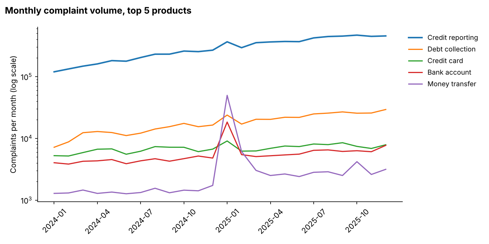
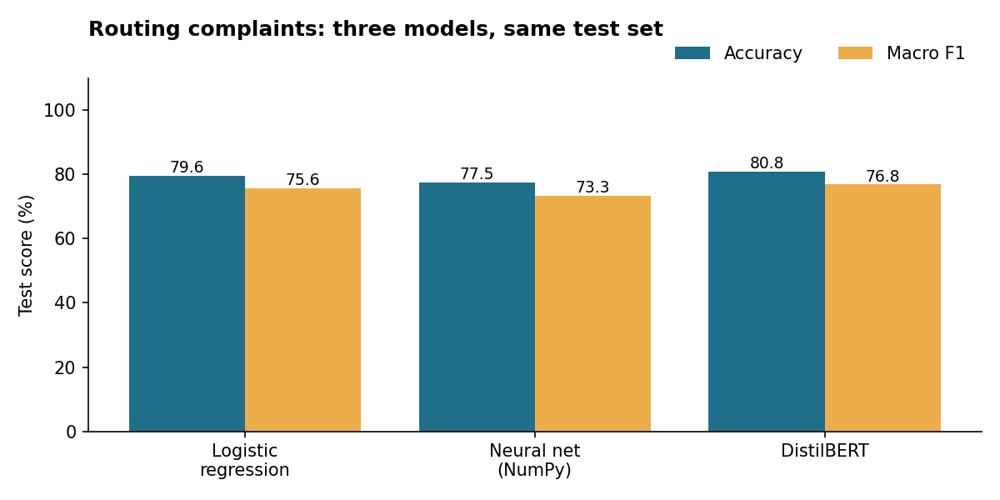

# Customer Complaint Intelligence

[](https://complaint-intelligence-fd4cjdcfwce4bpyrm89mgv.streamlit.app/)

**[View the live dashboard →](https://complaint-intelligence-fd4cjdcfwce4bpyrm89mgv.streamlit.app/)**

**What are bank customers actually complaining about, which problems are growing, and can a new complaint be sent to the right team automatically?**

Complaints filed with the Consumer Financial Protection Bureau are public, and for years many included the customer's own written story. This project scans 16.6 million complaint records and a sample of 45,597 written stories to find the main themes, track which issues are rising, build a search engine for similar past cases, and train three models to route new complaints to the right product team, including a neural network written from scratch and a fine-tuned DistilBERT.

I ran it as a six-sprint agile project. The backlog, user stories, and retrospectives are in [docs/agile_backlog.md](docs/agile_backlog.md).

---

## Key findings

From 8.2 million complaints filed in 2024 and 2025, and a balanced sample of 45,597 with written stories:

1. **Complaints doubled in a year.** Filings went from 2.7 million in 2024 to 5.4 million in 2025. Credit reporting alone grew from about 120,000 complaints a month to over 450,000 and makes up 88% of everything filed.
2. **January 2025 brought a one-month surge.** Money transfer complaints jumped 29x in a single month (1,731 to 49,743) before falling back, and bank account complaints spiked the same month. It looks like a coordinated campaign: in my sample, 17% of that month's money transfer complaints opened with the exact same sentence (vs 2% in other months), mostly templated complaints about Cash App and Zelle. The topic model picked out both groups on its own.
3. **Money transfer customers are the angriest.** Their average sentiment is -0.54, far below every other product (-0.14 overall).
4. **Debt collectors threatening legal action is the fastest-rising issue**, up 168% in late 2025 (from about 3,000 to 8,000 complaints a month).
5. **Search:** meaning-based embeddings found the best matches (61% same-product precision at 10), but my hand-built BM25 came within 2 points while running about 13x faster (1.1 ms vs 14.8 ms per query). The dashboard uses BM25.
6. **Routing:** fine-tuned DistilBERT routed complaints most accurately (80.8%), but the simple logistic regression baseline was close behind (79.6%) and trains on a regular CPU, while DistilBERT needed 10 minutes on a GPU. The from-scratch NumPy network reached 77.5%.





## Recommendation

For automatic routing, start with the logistic regression model. It gets within about one point of the transformer at a fraction of the cost, and it's easy to explain. Move to DistilBERT only if queue volume makes that extra point worth paying for. For monitoring, keep the spike detection running monthly. Rerun as of January 2025, it ranks the money transfer surge as the number one alert in its very first month, which is exactly when a complaints team needs to know.

**Where every model struggles:** debt management complaints are only recognized about a quarter of the time. They read a lot like debt collection and credit reporting complaints, so they're the first category to send to a person for review.

---

## What's in the dashboard

`streamlit run app.py` opens five tabs:

| Tab | Who it's for | What it does |
|---|---|---|
| Trends | Compliance, CX leads | Monthly volume by product and the fastest-growing issues |
| Topics and sentiment | CX leads | What complaints are about and which products make people angriest |
| Search past complaints | Agents | Type a problem in plain words, get the closest past cases (BM25) |
| Auto-route a complaint | Agents | Paste a complaint, the neural network picks the product team |
| How good is it? | Anyone checking the work | Accuracy of every model and search method, side by side |

---

## How it was built

| Sprint | Goal | Script | Course it draws on |
|---|---|---|---|
| 1 | Data pipeline | `src/sprint1_data.py` | Intro to Data Science |
| 2 | Topics, sentiment, rising issues | `src/sprint2_text_analytics.py` | NLP; Social Media and Web Analytics |
| 3 | Search engine | `src/sprint3_search.py`, `src/search.py` | Information Retrieval |
| 4 | Neural network from scratch | `src/sprint4_neural_net.py` | Intro to Neural Networks |
| 5 | DistilBERT fine-tuning | `src/sprint5_deep_learning.py` | Deep Learning |
| 6 | Dashboard | `src/sprint6_app_data.py`, `app.py` | |

## Decisions worth explaining

**Archived data.** My first run against the official CFPB export failed because the narrative column was gone. The CFPB had stopped publishing narratives in August 2026, so Sprint 1 now pulls an archived copy from before the change. It matches column names loosely, so it works with either the official or archived naming.

**Stable product groups.** The CFPB renames products every few years, so products are grouped by keyword ("credit report", "mortgage") instead of exact name.

**Capped sample.** Credit reporting is the large majority of all complaints. Each product is capped in the text sample so the models don't learn to always guess credit reporting. Trend charts still use every complaint.

**NMF for topics.** On TF-IDF features, NMF gives cleaner, more readable topics than LDA and runs much faster at this scale.

**VADER for sentiment.** It was built for short, emotional social media text, which is close to what complaints are. It measures tone, not whether a complaint is valid.

**BM25 written by hand.** Precomputing BM25 weights into a sparse matrix makes each query one matrix multiply, fast enough for live search. It matches a direct implementation of the formula exactly.

**Search relevance.** There are no human relevance labels, so a result counts as relevant when it shares the query complaint's product and issue. That's strict but consistent across methods.

**Neural network from scratch.** Forward pass, backprop, dropout, and Adam are all written in NumPy, and the gradients were checked numerically before training. TF-IDF features are compressed to 200 dimensions (LSA) first, since a 10,000-wide first layer would be slow and overfit.

**Same test set for every model.** The train/validation/test split is saved to disk, so DistilBERT is scored on exactly the same complaints as the simpler models.

**Small app bundle.** The live dashboard reads a 15,000-complaint sample and a compact model from `app_data/`, so it runs on Streamlit's free tier without downloading the raw data.

---

## Run it yourself

The easiest way is Google Colab with a GPU (Runtime > Change runtime type > T4 GPU).

```bash
git clone https://github.com/vamsikrishnachirumalla-sys/complaint-intelligence.git
cd complaint-intelligence
pip install -r requirements-gpu.txt

python src/sprint1_data.py             # downloads the complaint archive on first run (~1GB)
python src/sprint2_text_analytics.py
python src/sprint3_search.py
python src/sprint4_neural_net.py
python src/sprint5_deep_learning.py    # needs a GPU to finish in reasonable time
python src/sprint6_app_data.py
streamlit run app.py
```

To try everything offline with fake data first, run `python src/make_sample_data.py` before Sprint 1.

## Project structure

```
complaint-intelligence/
├── app.py                          dashboard
├── src/
│   ├── config.py                   shared paths and settings
│   ├── make_sample_data.py         practice data generator
│   ├── sprint1_data.py
│   ├── sprint2_text_analytics.py
│   ├── search.py                   BM25, TF-IDF and embedding search
│   ├── sprint3_search.py
│   ├── sprint4_neural_net.py
│   ├── sprint5_deep_learning.py
│   └── sprint6_app_data.py
├── app_data/                       small files the live dashboard reads
├── reports/                        findings, metrics and charts
├── docs/agile_backlog.md           epics, user stories, retros
├── requirements.txt                dashboard + sprints 1-4
└── requirements-gpu.txt            adds PyTorch for sprints 3 and 5
```

## Data source

Consumer Financial Protection Bureau, Consumer Complaint Database. Complaints are published after the CFPB removes personal information, and publication doesn't mean the CFPB has verified them.

On August 14, 2026, the CFPB stopped publishing complaint narratives, so the official download no longer includes the written stories. This project uses an archived Parquet copy made before that change, [Mouwiya/cfpb-consumer-complaints](https://huggingface.co/datasets/Mouwiya/cfpb-consumer-complaints) on Hugging Face, which keeps the narrative column.

---

Built by Vamsi Krishna Chirumalla · [Portfolio](https://vamsikrishnachirumalla.com) · [GitHub](https://github.com/vamsikrishnachirumalla-sys)
